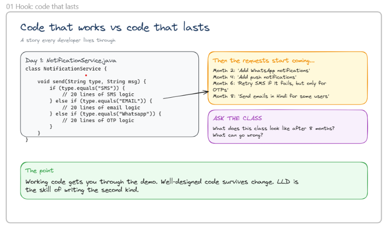
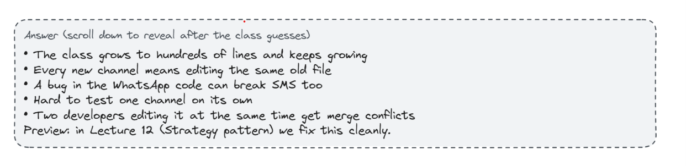
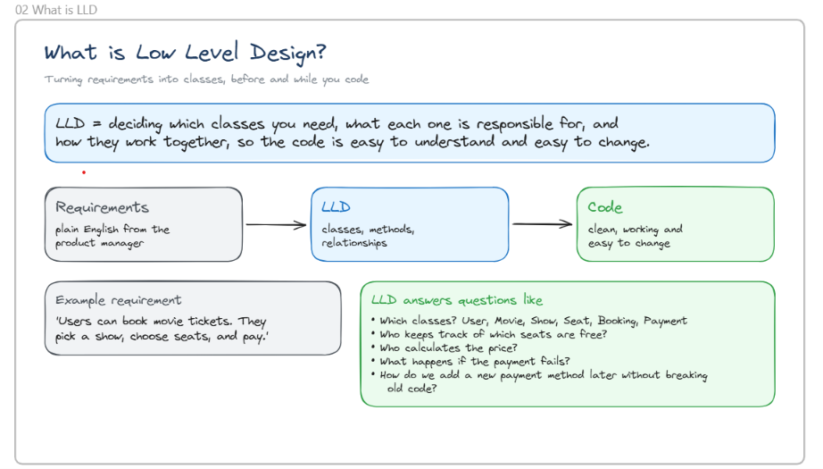

# 01. "Code That Works" vs "Code That Lasts"





*A story every developer lives through.*

---

## 1. The Initial Code (Day 1)

```java
class NotificationService {

    void send(String type, String msg) {

        if (type.equals("SMS")) {
            // 20 lines of SMS logic

        } else if (type.equals("EMAIL")) {
            // 20 lines of email logic

        } else if (type.equals("Whatsapp")) {
            // 20 lines of OTP logic
        }
    }
}
```

At first glance, this code looks perfectly fine.

The `NotificationService` class handles different notification types by checking the value of `type` and executing the appropriate logic.

### Examples

```java
send("SMS", "Hello");
```

Executes the SMS logic.

```java
send("EMAIL", "Hello");
```

Executes the Email logic.

---

## 2. Why Does This Design Look Good Initially?

On Day 1, the requirements are simple:

- SMS notifications
- Email notifications
- WhatsApp notifications

The code is:

- Short
- Easy to understand
- Fast to implement
- Enough to deliver the feature

Most developers would consider the task complete.

However, real-world software rarely remains unchanged.

---

## 3. Requirements Start Growing

As the product evolves, new business requirements arrive.

### Month 2

> Add WhatsApp notifications.

A new `else-if` block is added.

---

### Month 4

> Add Push notifications.

Another condition is added.

```java
else if(type.equals("PUSH"))
```

---

### Month 6

> Retry SMS if it fails, but only for OTPs.

The SMS block becomes more complex.

```java
if(isOTP){
    retry();
}
```

More conditions are introduced.

---

### Month 8

> Send emails in Hindi for some users.

The email logic becomes:

```java
if(language.equals("Hindi")){
    ...
}
```

Additional branching appears inside the existing code.

---

## 4. What Does the Class Look Like After 8 Months?

The once-simple class keeps growing.

```java
class NotificationService {

    if(type.equals("SMS")) {
        ...
        ...
    }
    else if(type.equals("EMAIL")) {
        ...
        ...
    }
    else if(type.equals("WHATSAPP")) {
        ...
        ...
    }
    else if(type.equals("PUSH")) {
        ...
        ...
    }
}
```

The class becomes:

- Longer
- More complicated
- Harder to maintain

---

## 5. Problems With This Design

### Problem 1: Violates Single Responsibility Principle (SRP)

The class is responsible for:

- SMS notifications
- Email notifications
- WhatsApp notifications
- Push notifications
- OTP retry logic
- Localization support

A single class is handling multiple responsibilities.

---

### Problem 2: Difficult to Extend

Whenever a new notification type is introduced, the existing class must be modified.

Examples:

- Telegram
- Slack
- Discord

Each addition requires changing existing code.

---

### Problem 3: Higher Risk of Bugs

Suppose a developer adds:

```java
else if(type.equals("TELEGRAM"))
```

While modifying the class, existing functionality may accidentally break:

- SMS
- Email
- WhatsApp

Every change becomes risky.

---

### Problem 4: Reduced Readability

A method that originally contained 20 lines can eventually grow to hundreds of lines.

Consequences:

- Hard to read
- Hard to debug
- Hard to onboard new developers

---

### Problem 5: Difficult Testing

Testing becomes more complicated because a single class contains many unrelated behaviors.

Developers must test:

- SMS flows
- Email flows
- Push flows
- Retry mechanisms
- Localization logic

all within the same class.

---

## 6. What Low-Level Design (LLD) Recommends

Instead of placing all logic inside one class, separate responsibilities.

### Step 1: Create an Interface

```java
interface Notification {
    void send(String msg);
}
```

---

### Step 2: Create Dedicated Implementations

#### SMS Notification

```java
class SMSNotification implements Notification {

    public void send(String msg) {
        // SMS logic
    }
}
```

#### Email Notification

```java
class EmailNotification implements Notification {

    public void send(String msg) {
        // Email logic
    }
}
```

#### WhatsApp Notification

```java
class WhatsAppNotification implements Notification {

    public void send(String msg) {
        // WhatsApp logic
    }
}
```

Each class now has a single responsibility.

---

## 7. Design Principles Being Introduced

### Single Responsibility Principle (SRP)

> A class should have only one reason to change.

Examples:

- SMS changes → only `SMSNotification`
- Email changes → only `EmailNotification`

Changes stay isolated.

---

### Open-Closed Principle (OCP)

> Software should be open for extension but closed for modification.

Adding a new notification type:

```java
class TelegramNotification implements Notification {
    ...
}
```

No need to modify existing notification classes.

---

### Strategy Pattern

Each notification type acts as a separate strategy.

Examples:

- SMSStrategy
- EmailStrategy
- WhatsAppStrategy
- PushStrategy

The correct strategy is selected at runtime.

---

## 8. Interview Perspective

### Question

**"What is wrong with the NotificationService implementation?"**

### Answer

1. It contains multiple responsibilities.
2. It uses a large `if-else` chain.
3. It violates the Single Responsibility Principle (SRP).
4. It violates the Open-Closed Principle (OCP).
5. It is difficult to maintain.
6. It is difficult to test.
7. Every new notification type requires modifying existing code.
8. It can be improved using the Strategy Pattern and Factory Pattern.

---

## 9. Key Takeaway

> **Working code gets you through the demo. Well-designed code survives change. LLD is the skill of writing the second kind.**

### Note:
- Any developer can write code that works today.
- Strong engineers write code that accommodates future changes.
- Good Low-Level Design focuses on maintainability, scalability, and extensibility.


# understanding LLD in simple way ?


## 02. What is Low-Level Design (LLD)?

*Turning requirements into classes, before and while you code.*

---

### 1. What is Low-Level Design?

Low-Level Design (LLD) is the process of deciding:

- Which classes are needed
- What responsibilities each class has
- How classes interact with each other
- What methods and relationships should exist

### Simple Definition

> **LLD is deciding which classes you need, what each one is responsible for, and how they work together so the code is easy to understand and easy to change.**

The goal is not just to write code that works, but to create a structure that remains maintainable as requirements grow.

---

## 2. The Journey From Requirement to Code

The slide shows a simple flow:

```text
Requirements
      ↓
      LLD
      ↓
     Code
```

### Step 1: Requirements

Requirements usually come in plain English from:

- Product Managers
- Business Analysts
- Clients
- Stakeholders

Example:

> "Users should be able to book movie tickets online."

At this stage, no classes or methods exist.

---

### Step 2: Low-Level Design (LLD)

This is where developers convert business requirements into technical building blocks.

LLD focuses on:

- Classes
- Methods
- Relationships
- Responsibilities
- Interactions

Questions such as:

- What objects do we need?
- How should they communicate?
- Where should business logic live?
- How can we keep the code maintainable?

are answered here.

---

### Step 3: Code

After the design is clear, implementation becomes easier.

The resulting code should be:

- Clean
- Readable
- Easy to test
- Easy to modify
- Easy to extend

A good design naturally leads to better code quality.

---

## 3. Example Requirement

The slide provides the following requirement:

> "Users can book movie tickets. They pick a show, choose seats, and pay."

At first glance, this looks like a simple sentence.

However, a software engineer must convert this requirement into a system design.

---

## 4. How Does LLD Think About This Requirement?

Instead of immediately writing code, LLD starts identifying the key entities.

From the requirement, we can identify:

### User

Represents a customer using the application.

Possible responsibilities:

```java
User
- userId
- name
- email
```

---

### Movie

Represents a movie available for booking.

```java
Movie
- movieId
- title
- duration
- language
```

---

### Show

Represents a specific screening of a movie.

```java
Show
- showId
- movie
- startTime
- theater
```

---

### Seat

Represents an individual seat.

```java
Seat
- seatNumber
- type
- availability
```

---

### Booking

Represents a user's reservation.

```java
Booking
- bookingId
- user
- selectedSeats
- amount
```

---

### Payment

Represents the payment transaction.

```java
Payment
- paymentId
- amount
- status
```

---

## 5. Questions LLD Helps Answer

The slide highlights several important design questions.

### Question 1: Which Classes Are Needed?

From the movie booking example, candidate classes include:

- User
- Movie
- Show
- Seat
- Booking
- Payment

LLD identifies the correct objects before coding begins.

---

### Question 2: Who Keeps Track of Free Seats?

Possible answer:

```java
class Show {
    List<Seat> seats;
}
```

The `Show` class can maintain all seat availability information.

This avoids scattering seat-management logic across multiple classes.

---

### Question 3: Who Calculates the Price?

Possible options:

```java
PricingService
```

or

```java
BookingService
```

LLD determines the best location for pricing logic.

For example:

```java
class PricingService {
    double calculatePrice(List<Seat> seats);
}
```

---

### Question 4: What Happens if Payment Fails?

LLD helps define the behavior.

Example:

```text
Booking Created
       ↓
Payment Fails
       ↓
Booking Cancelled
       ↓
Seats Released
```

These business flows are carefully designed during LLD.

---

### Question 5: How Can We Add a New Payment Method Later?

Today:

- Credit Card
- Debit Card

Tomorrow:

- UPI
- PayPal
- Apple Pay

A good design might use:

```java
interface PaymentMethod {
    void pay();
}
```

Implementations:

```java
CreditCardPayment
UPIPayment
PayPalPayment
```

This makes future additions easier and avoids modifying existing code.

---

## 6. Why Is LLD Important?

Without LLD, developers often:

- Start coding immediately
- Create large classes
- Duplicate logic
- Introduce tight coupling
- Make future changes difficult

With proper LLD:

- Responsibilities are clear
- Classes remain focused
- Code becomes modular
- New features are easier to add
- Maintenance costs decrease

---

## 7. LLD vs Direct Coding

### Direct Coding Approach

```text
Requirement
      ↓
    Code
```

Problems:

- Messy architecture
- Large classes
- High bug risk
- Difficult maintenance

---

### LLD Approach

```text
Requirement
      ↓
  Design Classes
      ↓
 Define Relationships
      ↓
      Code
```

Benefits:

- Clean architecture
- Better scalability
- Easier testing
- Easier future changes

---

## 8. Real Goal of LLD

Many beginners think:

> "LLD is drawing UML diagrams."

That is only a small part of it.

The real purpose of LLD is to answer:

- Who owns what responsibility?
- Where should business logic be placed?
- How should objects interact?
- How can the code remain maintainable after months or years?

---

## 9. Interview Perspective

### Question

**"What is Low-Level Design?"**

### Strong Answer

> Low-Level Design is the process of converting business requirements into classes, methods, objects, and relationships. It focuses on assigning clear responsibilities to classes and defining how they collaborate so that the resulting code is maintainable, extensible, and easy to understand.

---

## 10. Key Takeaway

> **LLD bridges the gap between business requirements and actual code.**

Requirements are written in human language, while software is built using classes and objects.

LLD is the process that transforms:

```text
Business Requirement
         ↓
  Classes & Methods
         ↓
      Clean Code
```

- A developer who understands LLD does not immediately start coding. Instead, the developer first thinks about the right classes, responsibilities, and relationships, ensuring the code remains clean and adaptable as requirements evolve.

- Low-Level Design (LLD) is the process of converting requirements into well-designed classes, methods, and relationships so that the resulting code is clean, maintainable, scalable, and easy to extend.