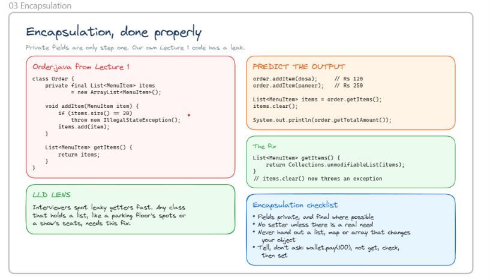

# Encapsulation, Done Properly

## Version 1 (Looks Encapsulated, But Isn't)

```java
class Order {

    // Private field ✅
    private final List<MenuItem> items = new ArrayList<>();

    void addItem(MenuItem item) {
        if (items.size() == 20) {
            throw new IllegalStateException();
        }

        items.add(item);
    }

    List<MenuItem> getItems() {

        // Returns actual list reference ❌
        return items;
    }
}
```

### What is happening?

```java
private final List<MenuItem> items;
```

```text
Looks safe because the field is private.
```

---

```java
order.addItem(dosa);
order.addItem(paneer);
```

```text
Items are added through a controlled method.
```

---

```java
List<MenuItem> items = order.getItems();
```

```text
Caller gets the actual internal list.
```

---

```java
items.clear();
```

```text
❌ Caller can modify Order's internal data.
```

---

```java
System.out.println(order.getTotalAmount());
```

```text
Total amount becomes incorrect because items were removed externally.
```

---

## The Problem

```java
private
```

does NOT automatically mean

```text
fully encapsulated
```

because:

```java
return items;
```

leaks the internal collection.

---

# Predict The Output

```java
order.addItem(dosa);   // Rs 120
order.addItem(paneer); // Rs 250

List<MenuItem> items = order.getItems();

items.clear();

System.out.println(order.getTotalAmount());
```

### What happens?

```text
All items are removed from the order.
```

---

```java
items.clear();
```

actually clears:

```java
order.items
```

because both references point to the same list.

---

# The Fix

```java
List<MenuItem> getItems() {

    return Collections.unmodifiableList(items);
}
```

### What is happening?

```java
getItems()
```

returns:

```text
Read-only view of the list.
```

---

```java
items.clear();
```

```text
❌ UnsupportedOperationException
```

---

```java
items.add(item);
```

```text
❌ UnsupportedOperationException
```

---

```java
order.addItem(item);
```

```text
✅ Only Order can modify its own data.
```

---

# Why This Is Better

```java
Order
```

controls:

```text
Adding items
Removing items
Business rules
Maximum item limits
Calculating totals
```

External code can only:

```text
Read data
```

not

```text
Modify data
```

---

# Encapsulation Checklist

## ✅ Keep Fields Private

```java
private List<MenuItem> items;
```

---

## ✅ Make Fields final When Possible

```java
private final List<MenuItem> items =
        new ArrayList<>();
```

```text
Reference cannot be reassigned.
```

---

## ✅ Don't Expose Internal Collections

Avoid:

```java
return items;
```

---

Prefer:

```java
return Collections.unmodifiableList(items);
```

---

## ✅ Don't Create Unnecessary Setters

Avoid:

```java
setBalance(...)
setPrice(...)
setStatus(...)
```

unless truly needed.

---

## ✅ Tell, Don't Ask

Instead of:

```java
wallet.getBalance();
wallet.setBalance(newBalance);
```

Prefer:

```java
wallet.pay(100);
wallet.refund(50);
```

Object manages its own state.


> Encapsulation is not just making fields `private`; it is ensuring that internal state cannot be modified except through controlled methods.