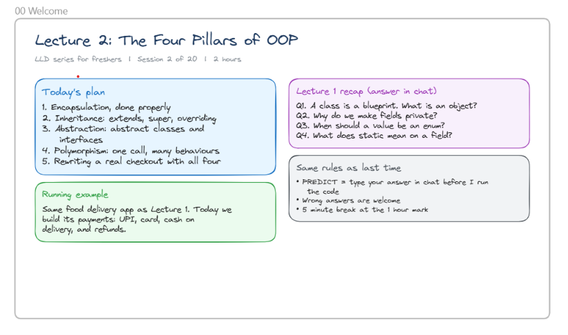
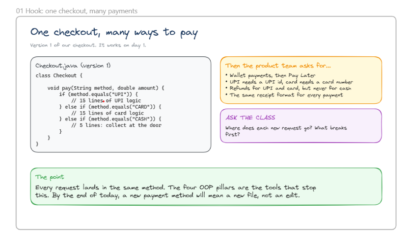
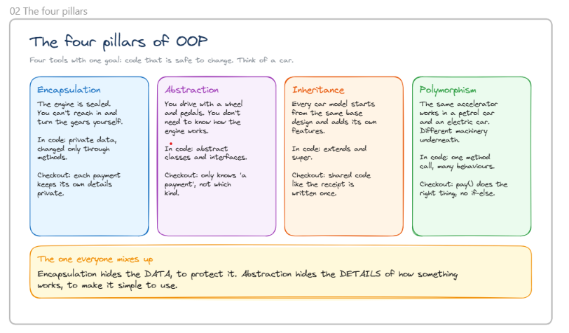

# Lecture 2: The Four Pillars of OOP



# Today's Plan

## 1. Encapsulation
Learn encapsulation properly, including:
- How to bundle data and behavior together.
- Access control using public/private/protected members.
- Data hiding principles.

## 2. Inheritance
Topics covered:
- `extends`
- `super`
- Method overriding

Purpose:
- Reuse existing code.
- Create parent-child class relationships.
- Customize inherited behavior.

## 3. Abstraction
Topics covered:
- Abstract classes
- Interfaces

Purpose:
- Hide implementation details.
- Expose only essential functionality.

## 4. Polymorphism
Key idea:
> One call, many behaviors

Meaning:
- Same method invocation can behave differently depending on the object.
- Achieved through overriding and interfaces.

## 5. Real-World Integration
Build a complete checkout flow using all four OOP pillars together.

---

# Running Example

Food Delivery Application

Using the same food delivery app from Lecture 1, implement:

### Payments
- UPI payments
- Card payments
- Cash on Delivery (COD)

### Other Features
- Order delivery
- Refund handling

Purpose:
- Understand OOP concepts through a practical system.

---

# Lecture 1 Recap Questions (Answered in Chat)

### Q1
A class is a blueprint.
What is an object? - An object is a real instance of a class that holds data and can perform actions.

### Q2
Why do we make fields private? -> Fields are made private to enforce encapsulation and protect data from unauthorized access.

### Q3
When should a value be represented as an enum? --> Use an enum when a value can only be one of a fixed set of predefined constants.

### Q4
What does `static` mean for a field? --> A static field belongs to the class itself and is shared by all objects of that class.


# static

```java
class Employee {

    // Shared by ALL Employee objects
    static String company = "Google";
}

public class Main {
    public static void main(String[] args) {

        Employee e1 = new Employee();
        Employee e2 = new Employee();

        // Access via class name
        System.out.println(Employee.company); // Google

        // Changing once affects everyone
        Employee.company = "Microsoft";

        System.out.println(e1.company); // Microsoft
        System.out.println(e2.company); // Microsoft
    }
}
```

### Remember

> `static` = One copy per class, shared by all objects.

# final

```java
public class Main {
    public static void main(String[] args) {

        // Constant value
        final int MAX_USERS = 100;

        System.out.println(MAX_USERS);

        // MAX_USERS = 200; // ❌ Compile-time error
    }
}
```

### Remember

> `final` variable = value cannot be reassigned.

# static final

```java
class Constants {

    // One shared copy + cannot change
    static final double PI = 3.14159;
}

public class Main {
    public static void main(String[] args) {

        System.out.println(Constants.PI);

        // Constants.PI = 4.0; // ❌ Compile-time error
    }
}
```

### Remember

> `static` = shared by all objects  
> `final` = cannot change

Together:

> `static final` = one shared constant for the entire application.

# enum

```java
// Only these values are allowed
enum PaymentMethod {
    UPI,
    CARD,
    COD
}

public class Main {
    public static void main(String[] args) {

        PaymentMethod method = PaymentMethod.UPI;

        System.out.println(method);

        // method = "Cash"; // ❌ Not allowed
    }
}
```

### Remember

> `enum` = restrict a variable to a fixed set of valid values.

- summary:
    - static	Belongs to class, shared by all objects
    - final	Cannot be changed
    - static final	Shared constant
    - enum	Fixed set of predefined values


# One Checkout, Many Ways to Pay



## Step 1: Initial Checkout Design (Version 1)

```java
class Checkout {

    void pay(String method, double amount) {

        if (method.equals("UPI")) {
            // UPI payment logic

        } else if (method.equals("CARD")) {
            // Card payment logic

        } else if (method.equals("CASH")) {
            // Cash on Delivery logic
        }
    }
}
```

### What's happening?

```java
checkout.pay("UPI", 500);
checkout.pay("CARD", 500);
checkout.pay("CASH", 500);
```

- One method handles all payment types.
- Uses `if-else` to decide which payment logic to run.
- Works fine initially.

---

## Step 2: Product Team Adds New Requirements

```text
Current:
✅ UPI
✅ CARD
✅ CASH
```

New requirements:

```text
✅ Wallet payments
✅ Pay Later
✅ UPI needs a UPI ID
✅ Card needs card details
✅ Refunds for UPI and Card
✅ Same receipt format for all payments
```

---

## Step 3: What Happens to the Code?

### Before

```java
if (UPI) {
    ...
}
else if (CARD) {
    ...
}
else if (CASH) {
    ...
}
```

### After

```java
if (UPI) {
    ...
}
else if (CARD) {
    ...
}
else if (CASH) {
    ...
}
else if (WALLET) {
    ...
}
else if (PAY_LATER) {
    ...
}
```

Problem:

- The method keeps growing.
- Every new payment requires editing existing code.
- Higher chance of bugs.
- Harder to test and maintain.

---

## Step 4: First Design Smell

```java
void pay(String method, ...)
```

Why is this bad?

```java
pay("UPI", ...);
pay("CARD", ...);
pay("WALLET", ...);
pay("PAY_LATER", ...);
```

Every payment behaves differently, but everything is forced into a single method.

---

## Step 5: Business Logic Becomes Mixed

```java
if (UPI) {
    // payment
    // refund
    // receipt
}

if (CARD) {
    // payment
    // refund
    // receipt
}

if (CASH) {
    // payment
    // receipt
}
```

Now one method is managing:

- Payment processing
- Refunds
- Receipt generation
- Payment-specific validations

Too many responsibilities.

---

## Step 6: Question Asked in Class

```text
Where does each new request go?
```

Answer:

```text
Into the same pay() method.
```

---

## Step 7: What Breaks First?

```text
1. Maintainability
2. Readability
3. Testability
4. Extensibility
```

Every new payment type means:

```text
Open existing file
↓
Modify pay()
↓
Retest everything
↓
Risk breaking old payments
```

---

## Main Problem

```java
class Checkout {
    void pay(String method, double amount) {
        // all payment logic here
    }
}
```

Everything depends on one growing method.

---

## Key Takeaway

> The goal of OOP is to avoid giant `if-else` chains where every new feature requires editing existing code.

By the end of the lecture:

```text
Adding UPI      -> New file
Adding Wallet   -> New file
Adding PayLater -> New file
```

Instead of:

```text
Open Checkout.java
Modify pay()
Add more if-else
Hope nothing breaks
```

> If adding a new payment method requires editing existing payment code, the design is not easily extensible and is a good candidate for OOP abstractions and polymorphism.


# The Four Pillars of OOP



## Goal

> Write code that is easy and safe to change.

### Real-Life Analogy

Think of a **car**.

You can drive the car without knowing:
- How the engine works
- How fuel is injected
- How gears are implemented

OOP applies the same idea to software.

---

# 1. Encapsulation

## Car Example

```text
Engine is sealed.
You cannot directly touch internal parts.
```

You interact through:

```text
Accelerator
Brake
Steering wheel
```

---

## Java Example

```java
class Payment {

    // Hidden from outside classes
    private double balance = 1000;

    // Controlled access - method
    public void withdraw(double amount) {
        balance -= amount;
    }
}
```

### What does encapsulation do?

```java
payment.balance = -1000; // ❌ Not allowed
payment.withdraw(100);   // ✅ Allowed
```

Data is protected and can only be changed through methods.

### Checkout Example

```java
class UpiPayment {

    private String upiId;
}
```

Each payment method keeps its own details private.

---

## Remember

> Encapsulation hides and protects data.

---

# 2. Abstraction

## Car Example

```text
Press accelerator → Car moves.
```

You don't need to know:

```text
Fuel injection
Engine timing
Gear mechanics
```

Only the essential controls are exposed.

---

## Java Example

```java
interface PaymentMethod {
    void pay(double amount);
}
```

Usage:

```java
payment.pay(500);
```

Caller only knows:

```text
"Pay 500"
```

Caller does NOT know:

```text
How UPI works
How Card works
How Wallet works
```

---

### Checkout Example

```java
PaymentMethod payment = new UpiPayment();
payment.pay(500);
```

Checkout knows:

```text
This is a payment.
```

Checkout does NOT care:

```text
UPI?
Card?
Wallet?
```

---

## Remember

> Abstraction hides implementation details and exposes only what users need.

---

# 3. Inheritance

## Car Example

Every car starts with a common base:

```text
Engine
Wheels
Steering
```

Then each model adds its own features.

```text
SUV     → Sunroof
Sports  → Turbo Engine
Electric→ Battery Pack
```

---

## Java Example

```java
class Payment {

    void generateReceipt() {
        System.out.println("Receipt generated");
    }
}
```

```java
class UpiPayment extends Payment {

}
```

```java
class CardPayment extends Payment {

}
```

Now both classes inherit:

```java
generateReceipt();
```

without rewriting it.

---

### Checkout Example

Shared logic:

```java
Receipt
Validation
Logging
```

Written once.

Used everywhere.

---

## Remember

> Inheritance allows child classes to reuse code from a parent class.

---

# 4. Polymorphism

## Car Example

Same action:

```text
Press accelerator
```

Different cars respond differently.

```text
Petrol Car    → Engine revs
Electric Car  → Motor spins
```

Same command.

Different behavior.

---

## Java Example

```java
interface PaymentMethod {
    void pay(double amount);
}
```

```java
class UpiPayment implements PaymentMethod {

    public void pay(double amount) {
        System.out.println("Paid using UPI");
    }
}
```

```java
class CardPayment implements PaymentMethod {

    public void pay(double amount) {
        System.out.println("Paid using Card");
    }
}
```

Usage:

```java
PaymentMethod payment = new UpiPayment();
payment.pay(500);
```

or

```java
PaymentMethod payment = new CardPayment();
payment.pay(500);
```

Same call:

```java
payment.pay(500);
```

Different behavior.

---

### Checkout Example

```java
payment.pay(amount);
```

No:

```java
if(method.equals("UPI"))
```

No:

```java
else if(method.equals("CARD"))
```

No giant if-else chain.

---

## Remember

> One method call, many possible behaviors.

---

# Common Interview Confusion

## Encapsulation vs Abstraction

### Encapsulation

```java
private double balance;
```

Focus:

```text
Protecting data
```

Question:

```text
Who can access the data?
```

---

### Abstraction

```java
payment.pay(500);
```

Focus:

```text
Hiding complexity
```

Question:

```text
What should the user see?
```

---

## Note:
> Encapsulation hides the DATA to protect it, while Abstraction hides the IMPLEMENTATION details to simplify usage.
---

### key Notes:
> Abstraction hides implementation details and exposes only what users need.

> Encapsulation hides and protects data.

> Inheritance allows child classes to reuse code from a parent class.

> PolyMorphism: One method call, many possible behaviors.
    - one thing but different forms.


> The four pillars of OOP help build software that is modular, reusable, extensible, and easy to change.

